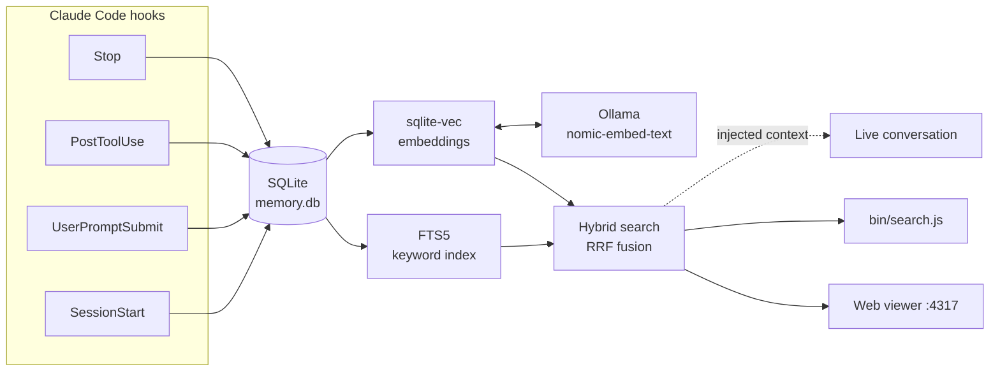

<p align="center">
  
</p>

<h1 align="center">Agents RAM</h1>

<p align="center">
  <b>One persistent memory for Claude Code, Codex and Cursor that never leaves your machine.</b><br>
  No login, no cloud, no token, no subscription — just SQLite, local embeddings, four hooks and an MCP server.
</p>

<p align="center">
  
  
  
  
</p>

---

Coding agents forget everything the moment a session ends. Agents RAM fixes that by hooking into
the session lifecycle, writing a compact record of what happened to a local SQLite database, and
feeding relevant memory back in at the right moments — so your agent stops asking you to re-explain
decisions you already made yesterday. Claude Code, Codex and Cursor all share the same memory:
what you decided in one is there when you open another.

> Formerly **Claude RAM**. Existing installs keep working: `CLAUDE_RAM_*` variables are still read,
> and data in `~/.claude/claude-ram/` is used until you move it. `node bin/install.js` replaces
> the old hook and MCP entries.

It was built as a minimal, self-hosted alternative for people who want the "persistent memory"
idea without an account, a hosted service, or a companion token — everything here fits in a few
hundred lines you can read in one sitting.

## Table of contents

- [Features](#features)
- [How it works](#how-it-works)
- [Requirements](#requirements)
- [Installation](#installation)
- [Usage](#usage)
- [Configuration](#configuration)
- [Privacy](#privacy)
- [Uninstall](#uninstall)
- [Limitations & roadmap](#limitations--roadmap)
- [License](#license)

## Features

- **100% local** — everything lives in `~/.local/share/agents-ram/memory.db`. No account, no network
  calls except to your own Ollama instance on `localhost`.
- **Hybrid search** — SQLite FTS5 (keyword) and local embeddings via [Ollama](https://ollama.com)
  (`nomic-embed-text`) fused with Reciprocal Rank Fusion, so both literal and conceptual matches
  surface ("login" finds a memory about "JWT authentication" even with zero shared words).
- **Calibrated relevance threshold** — vector search always returns *a* closest match even when
  nothing is actually relevant; a cosine-distance cutoff (empirically tuned, see
  [`lib/db.js`](lib/db.js)) keeps irrelevant memory from being injected into every prompt.
- **Four lightweight hooks** — `SessionStart`, `UserPromptSubmit`, `PostToolUse`, `Stop`. No
  background daemon of its own; Ollama is the only optional long-running process.
- **Built-in web dashboard** — a local viewer (`npm run viewer`) with project filtering, live
  hybrid search, an activity chart, and disk usage — served entirely from `127.0.0.1`.
- **Privacy tags** — wrap anything in `<private>...</private>` and it's redacted before it ever
  touches disk.
- **Graceful degradation** — if Ollama isn't running, everything falls back to keyword-only
  search automatically. Nothing breaks your session.

## How it works



Every observation is tagged with the project's `cwd`, so memory from one project never leaks
into another. Each hook fails safe: any internal error is logged to stderr and swallowed — a bug
in Agents RAM will never break your agent's session.

## Requirements

- Node.js 20+ (uses the native `fetch` API)
- [Claude Code](https://claude.com/claude-code)
- Optional, for semantic search: [Ollama](https://ollama.com) with the `nomic-embed-text` model
  (falls back to keyword-only search if not installed)

## Installation

```bash
git clone https://github.com/<your-username>/agents-ram.git
cd agents-ram
npm install
```

Register the hooks and the MCP server in every client you use with one command:

```bash
node bin/install.js                  # Claude Code, plus Codex and Cursor if ~/.codex or ~/.cursor exist
node bin/install.js --client cursor  # just one: claude | codex | cursor
node bin/install.js --dry-run        # show what would change, write nothing
node bin/install.js --uninstall      # remove only Agents RAM's entries
```

It is idempotent, keeps everything else in each file, and saves a `.bak` before changing one.
In Codex, run `/hooks` once afterwards to trust the new hooks.

To do it by hand instead, register the four hooks in `~/.claude/settings.json` (merge this into
your existing `"hooks"` key if you already have one) — replace `/absolute/path/to/agents-ram` with
wherever you cloned it:

```json
{
  "hooks": {
    "SessionStart": [
      { "hooks": [{ "type": "command", "command": "node /absolute/path/to/agents-ram/hooks/session-start.js" }] }
    ],
    "UserPromptSubmit": [
      { "hooks": [{ "type": "command", "command": "node /absolute/path/to/agents-ram/hooks/user-prompt-submit.js" }] }
    ],
    "PostToolUse": [
      { "hooks": [{ "type": "command", "command": "node /absolute/path/to/agents-ram/hooks/post-tool-use.js" }] }
    ],
    "Stop": [
      { "hooks": [{ "type": "command", "command": "node /absolute/path/to/agents-ram/hooks/stop.js" }] }
    ]
  }
}
```

That's it — keyword search works immediately. To enable semantic search too:

```bash
curl -fsSL https://ollama.com/install.sh | sh   # installs Ollama as a system service
ollama pull nomic-embed-text                     # ~275MB, one-time download
```

## Usage

**Search from the terminal:**

```bash
node bin/search.js "jwt authentication"     # hybrid search in the current project
node bin/search.js --recent                 # recent activity in the current project
node bin/search.js "something" --project /path/to/other/project
```

Optionally expose it as a global command:

```bash
npm link      # now `mem-search "query"` works anywhere
```

**Web dashboard:**

```bash
npm run viewer
```

Open `http://localhost:4317` — project and client filter (Claude Code / Codex / Cursor, shown once
more than one client has stored memory), live hybrid search, per-kind counters, a 14-day
activity chart, and total disk usage. The server only binds to `127.0.0.1`.

**Health check** — run this first if memory seems to "not remember" things:

```bash
node bin/doctor.js
```

It verifies the four hooks are registered (for Claude Code, and for Codex and Cursor when their
config folders exist), that the MCP server is registered in each client, that prompts and responses are being stored in a sane
ratio, how many recent rows have a vector, that Ollama answers (and how fast), and shows the last
hook errors from the last 7 days. Exits with code 1 when something needs fixing. Read-only;
`node bin/doctor.js --clear-errors` empties the error log once you've dealt with old errors.

**Backfill vectors.** Rows stored while Ollama was off or its model was cold have no vector and
are invisible to semantic search. `SessionStart` completes up to 300 of them in the background on
every session; to do it all at once:

```bash
node bin/backfill-embeddings.js            # everything pending
node bin/backfill-embeddings.js --limit 300 --quiet
```

`Read`, `Glob` and `Grep` calls are never embedded (keyword search finds them fine and they are
~40% of the volume).

**Retention** (`tool_use` rows lose value quickly and are ~95% of the database):

```bash
node bin/prune.js                # dry run: how many tool_use rows are older than 30 days
node bin/prune.js --days 14 --apply
```

To prune automatically at every session start, opt in with `AGENTS_RAM_PRUNE_DAYS=30` (minimum 7)
in your environment. Without it nothing is ever deleted.

**Scrub old rows** stored before secret redaction existed:

```bash
node bin/scrub.js                # dry run: how many rows would change
node bin/scrub.js --apply
```

**Tests** (use a temporary database, never yours): `npm test`.

### One memory for Claude Code, Codex and Cursor (MCP)

`bin/mcp.js` is a dependency-free MCP server over stdio on top of the same `memory.db`, so every
client reads and writes one knowledge base. Tools: `memory_search` (hybrid search, current
project by default or `all_projects`), `memory_recent` (latest prompts, answers and notes) and
`memory_save` (store a note, with the same secret redaction as the hooks). Each row records which
client stored it in a `source` column (`claude`, `codex`, `cursor`), taken from the MCP
handshake; older rows are `claude`.

`node bin/install.js` registers all of this for you. By hand, use absolute paths (GUI apps often
don't see nvm's `PATH`):

```bash
claude mcp add --scope user agents-ram -- "$(command -v node)" /path/to/agents-ram/bin/mcp.js
```

```jsonc
// ~/.cursor/mcp.json
{ "mcpServers": { "agents-ram": { "command": "/abs/path/to/node", "args": ["/path/to/agents-ram/bin/mcp.js"] } } }
```

```toml
# ~/.codex/config.toml
[mcp_servers.agents-ram]
command = "/abs/path/to/node"
args = ["/path/to/agents-ram/bin/mcp.js"]
```

**Automatic capture in Codex and Cursor.** The same four hooks run for every client; the command
says which one with `--client codex|cursor` (no flag means Claude Code), and `lib/hook-io.js`
translates the input and output. Codex speaks the Claude Code protocol as-is; Cursor sends
`conversation_id`, `workspace_roots`, `text` and `tool_output`, and reads `additional_context`.

```jsonc
// ~/.codex/hooks.json — then run /hooks inside Codex once to trust them
{ "hooks": {
  "SessionStart":     [{ "hooks": [{ "type": "command", "command": "node /path/to/agents-ram/hooks/session-start.js --client codex" }] }],
  "UserPromptSubmit": [{ "hooks": [{ "type": "command", "command": "node /path/to/agents-ram/hooks/user-prompt-submit.js --client codex" }] }],
  "PostToolUse":      [{ "hooks": [{ "type": "command", "command": "node /path/to/agents-ram/hooks/post-tool-use.js --client codex" }] }],
  "Stop":             [{ "hooks": [{ "type": "command", "command": "node /path/to/agents-ram/hooks/stop.js --client codex" }] }]
} }
```

```jsonc
// ~/.cursor/hooks.json
{ "version": 1, "hooks": {
  "sessionStart":       [{ "command": "node /path/to/agents-ram/hooks/session-start.js --client cursor" }],
  "beforeSubmitPrompt": [{ "command": "node /path/to/agents-ram/hooks/user-prompt-submit.js --client cursor" }],
  "postToolUse":        [{ "command": "node /path/to/agents-ram/hooks/post-tool-use.js --client cursor" }],
  "afterAgentResponse": [{ "command": "node /path/to/agents-ram/hooks/stop.js --client cursor" }]
} }
```

| | Claude Code | Codex | Cursor |
|---|---|---|---|
| Recent memory at session start | yes | yes | yes |
| Relevant memory injected per prompt | yes | yes | no — `beforeSubmitPrompt` can only allow or block; use `memory_search` |
| Prompts, answers and tool calls stored | yes | yes | yes |

### Brain view

The viewer has a **🧠 Cerebro** tab: every prompt and answer is a neuron, linked to its
3 nearest semantic neighbours (embedding cosine distance < 0.4) and to the previous memory of
its session. Drag to rotate, wheel to zoom, click a neuron for details, click a project in the
legend to focus it, and use the search box to light up the matching neurons. A button appears
when new memories arrive. Requires embeddings (`node bin/backfill-embeddings.js`).

### Obsidian export

`npm run export-obsidian [dir]` writes one note per session and per project, with wikilinks
between related sessions, to `~/agents-ram-vault` by default (`~/claude-ram-vault` if that one already exists). Open that folder as a vault and
use Obsidian's graph view. Keep it separate from any hand-curated vault.

## Configuration

All tunables are plain constants, no config file needed:

| Constant | File | Default | Purpose |
|---|---|---|---|
| `SEMANTIC_DISTANCE_THRESHOLD` | `lib/db.js` | `0.3` | Max cosine distance for a semantic match to be considered relevant |
| `INJECT_LIMIT` | `hooks/user-prompt-submit.js` | `3` | Max memories injected per prompt |
| `RECENT_LIMIT` | `hooks/session-start.js` | `8` | Max memories injected at session start |
| `LINE_MAX_CHARS` | hooks | `240-260` | Truncation length for injected lines (keeps head and tail) |
| `minTerms` | `hybridSearch` in `lib/db.js` | `2` | Keyword matches must share at least this many significant terms with the prompt |
| `EMBED_SKIP_TOOLS` | `lib/db.js` | `Read, Glob, Grep, LS, ToolSearch` | Tools whose observations are not embedded |
| `EMBED_TIMEOUT_MS` | hooks | `600-1500` | How long a blocking hook waits for Ollama (cold start takes ~7 s; the backfill waits longer) |
| `AGENTS_RAM_VIEWER_PORT` | env var | `4317` | Port for the web dashboard |
| `AGENTS_RAM_PRUNE_DAYS` | env var | unset | Opt-in: delete `tool_use` rows older than N days (min 7) at session start |
| `AGENTS_RAM_DB_DIR` | env var | `~/.local/share/agents-ram` (`$XDG_DATA_HOME` if set) | Where the database and logs live (tests use a temp dir) |
| `OLLAMA_URL` | env var | `http://localhost:11434` | Ollama endpoint |
| `AGENTS_RAM_SOURCE` | env var | from MCP client name | Force the `source` recorded by `bin/mcp.js` |

**Project scope.** A session in `/a/b/c` shares memory with that folder, its subfolders and its
parent folders (down to, but excluding, your home directory), so `apps`, `apps/api` and
`apps/api/src` count as one project even without git. The dashboard counters stay per exact path.

## Privacy

- Everything is stored in one file: `~/.local/share/agents-ram/memory.db`. Nothing is uploaded
  anywhere — the only outbound calls are to your own local Ollama instance.
- Wrap sensitive text in `<private>...</private>` in a prompt or response and it's replaced with
  `[redacted]` before it's ever written to disk.
- Common secrets are redacted before anything is written: prefixed keys (`GOCSPX-`, `sk-`, `ghp_`,
  `AKIA…`), JWTs, `Bearer` tokens, passwords inside URLs, long hex strings (32+ chars) and
  `NAME=value` / `NAME: value` pairs whose name contains secret, password, token or key. This is
  pattern matching, not a guarantee: a secret with no known prefix and no telling name next to it
  is not detected. Vectors do not contain the original text.
- Memory is scoped per project directory — nothing crosses between unrelated projects.
- Hook failures are swallowed so they never break a session, but they are appended to
  `~/.local/share/agents-ram/hook-errors.log` (capped at 100 KB) and shown by `bin/doctor.js`.

## Uninstall

1. `node bin/install.js --uninstall` removes the hooks and the MCP server from every client.
2. Delete `~/.local/share/agents-ram/` to wipe all stored memory.
3. Optional: `sudo systemctl disable --now ollama` if you don't use it for anything else.

## Limitations & roadmap

- The relevance threshold (0.3) is a hand-calibrated heuristic, re-measured on 2026-10-08: related
  queries landed at 0.18–0.29, unrelated ones at 0.32–0.42. The gap is narrow, so it may need
  retuning depending on how you write prompts (see the comment in `lib/db.js`).
- Ollama unloads the model after 5 minutes idle by default. Requests now ask for `keep_alive: 1h`,
  and `SessionStart` warms it in the background, but the first prompt after a long idle can still
  go without semantic results (it falls back to keyword search).
- Near-duplicate notes (same topic, Jaccard ≥ 0.6 on significant terms) keep only the newest one.
  This helps with "X is missing" followed by "X is fixed", but it cannot detect contradictions
  that use different words.
- Each hook still pays Node + SQLite startup (~300 ms per tool call, not optimized).
- Semantic search does a broad top-K vector scan and filters by project in JS rather than using
  `sqlite-vec`'s partition-key feature — simpler, and fast enough at personal-memory scale, but
  not built to scale to a shared/multi-tenant setup.
- Retention is opt-in (`bin/prune.js`, `AGENTS_RAM_PRUNE_DAYS`); there is no pruning UI.
- Ideas welcome: an MCP tool for on-demand deeper search, a systemd user service for the viewer.

## License

[ISC](LICENSE)
