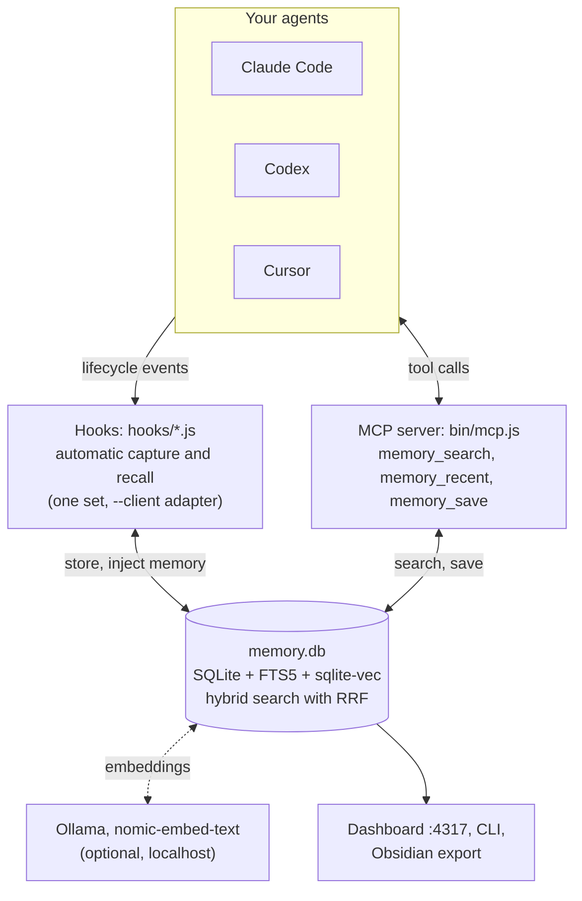

<p align="center">
  
</p>

<h1 align="center">Agents RAM</h1>

<p align="center">
  <b>One persistent, local memory shared by Claude Code, Codex and Cursor.</b><br>
  No account, no cloud, no API key, no subscription. Just SQLite, local embeddings, four hooks and an MCP server.
</p>

<p align="center">
  
  
  
  
  
</p>

---

Coding agents forget everything when a session ends. The next morning you explain the same
architecture, the same conventions and the same bug you already fixed, and if you switch from
Claude Code to Cursor or Codex, you start from zero again.

**Agents RAM** gives all of them one shared, long-term memory that lives on your machine. It
listens to each session through the agents' own hook systems, stores a compact record of what was
asked, answered and done in a local SQLite database, and feeds the relevant parts back at the
right moment. A decision made in Cursor at 10:00 is there when you open Claude Code at 15:00.

The whole thing is a few hundred lines of plain Node.js you can read in one sitting.

> Formerly **Claude RAM**. Existing installs keep working; see
> [Migrating from Claude RAM](#migrating-from-claude-ram).

## Contents

- [Highlights](#highlights)
- [Supported clients](#supported-clients)
- [Quick start](#quick-start)
- [How it works](#how-it-works)
- [Installation](#installation)
- [Using it](#using-it)
- [Maintenance](#maintenance)
- [Configuration](#configuration)
- [Privacy and security](#privacy-and-security)
- [Troubleshooting](#troubleshooting)
- [Project layout](#project-layout)
- [Development](#development)
- [Migrating from Claude RAM](#migrating-from-claude-ram)
- [Uninstall](#uninstall)
- [Limitations and roadmap](#limitations-and-roadmap)
- [License](#license)

## Highlights

- **One knowledge base for every agent.** Claude Code, Codex and Cursor read and write the same
  database. Every record keeps track of which client stored it.
- **Automatic.** Hooks capture prompts, answers and tool calls, and inject relevant memory without
  you doing anything. The agents can also search and save notes on demand through MCP.
- **100% local.** One SQLite file on your disk. The only network calls go to your own Ollama on
  `localhost`, and only if you install it.
- **Hybrid search.** Keyword search (SQLite FTS5) and semantic search (local embeddings with
  `nomic-embed-text` via [Ollama](https://ollama.com)), fused with Reciprocal Rank Fusion. "login"
  finds a note about "JWT authentication" even with no words in common.
- **Precision over recall.** A calibrated distance threshold, a minimum shared-term rule and
  near-duplicate removal keep unrelated memory out of your prompts.
- **Private by default.** Common secrets are redacted before anything touches disk, and
  `<private>...</private>` blocks are never stored.
- **Fails safe.** If anything breaks inside Agents RAM, the error is logged and your session
  continues untouched. Without Ollama, it quietly falls back to keyword search.
- **See your memory.** A local dashboard with filters, search, activity charts and a 3D graph of
  how your memories connect, plus an Obsidian export.

## Supported clients

| | Claude Code | Codex | Cursor |
|---|:---:|:---:|:---:|
| Recent project memory at session start | yes | yes | yes |
| Relevant memory injected with each prompt | yes | yes | no (1) |
| Prompts, answers and tool calls stored automatically | yes | yes | yes |
| `memory_search`, `memory_recent`, `memory_save` over MCP | yes | yes | yes |

(1) Cursor's `beforeSubmitPrompt` hook can only allow or block a prompt, not add context. In
Cursor the agent gets memory at session start and through the MCP tools.

## Quick start

```bash
git clone https://github.com/<your-username>/agents-ram.git
cd agents-ram
npm install
node bin/install.js        # registers hooks + MCP in every client it finds
node bin/doctor.js         # checks that everything is wired up
```

Restart your agents. In Codex, run `/hooks` once to trust the new hooks. That's it: keyword
search works right away. For semantic search, also install Ollama
([details below](#3-optional-enable-semantic-search)).

## How it works



### Two ways in

1. **Hooks (automatic).** Each client runs a small Node script on lifecycle events. The scripts are
   the same for all three clients; a `--client codex|cursor` flag tells
   [`lib/hook-io.js`](lib/hook-io.js) how to translate that client's input and output formats.
2. **MCP server (on demand).** [`bin/mcp.js`](bin/mcp.js) is a dependency-free MCP server over
   stdio. The agent can call it whenever it needs to look something up or remember something.

### What each hook does

| Event (Claude Code / Codex) | Cursor event | Script | What it does |
|---|---|---|---|
| `SessionStart` | `sessionStart` | `session-start.js` | Injects the 8 most recent prompts, answers and notes of this project. Starts a background job that fills in missing embeddings and warms up the model. |
| `UserPromptSubmit` | `beforeSubmitPrompt` | `user-prompt-submit.js` | Stores the prompt. Runs a hybrid search with it and injects up to 3 relevant memories from earlier sessions. |
| `PostToolUse` | `postToolUse` | `post-tool-use.js` | Stores a one-line summary of the tool call (command run, file edited, search made). |
| `Stop` | `afterAgentResponse` | `stop.js` | Stores the agent's final answer (one-line replies are skipped). |

Injected memory is always labelled as unverified notes with their date, so the agent checks the
current state before trusting it.

### Data model

Everything lives in one table, `observations`, with a full-text index and a vector index next to it:

| Column | Meaning |
|---|---|
| `kind` | `user_prompt`, `session_summary` (an answer), `tool_use` or `note` (saved through MCP) |
| `summary` | The compact, redacted text that is indexed and shown |
| `project_path` | The working directory of the session |
| `session_id` | The client's session or conversation ID |
| `source` | Which client stored it: `claude`, `codex` or `cursor` |
| `tool_name`, `detail`, `created_at` | Extra metadata |

### How search decides what is relevant

1. **Keywords.** The query is reduced to its significant terms (accents, stopwords in English and
   Spanish and very short words are removed) and matched with FTS5. A hit must share at least two
   significant terms with the query, so a single common word is not enough.
2. **Meaning.** The query is embedded locally and compared with stored vectors by cosine distance.
   Only matches closer than `0.3` count. Vector search always returns some nearest match, even
   when nothing is relevant, so this cutoff is what keeps noise out. It was calibrated on real data
   (related queries 0.18-0.29, unrelated 0.32-0.42).
3. **Fusion.** Both rankings are combined with Reciprocal Rank Fusion, so a memory that ranks well
   in either list rises to the top.
4. **Clean-up.** Notes that say almost the same thing (Jaccard similarity of 0.6 or more) keep only
   the newest one, so "X is broken" does not come back after "X is fixed". Memories from the current
   session are skipped, because they are already in the conversation.

### Project scope

Memory is scoped by folder. A session in `/a/b/c` sees memory from that folder, its subfolders and
its parent folders down to (but not including) your home directory, so a monorepo's `apps`,
`apps/api` and `apps/api/src` behave as one project, with or without git. Unrelated projects never
see each other's memory.

## Installation

### Requirements

- Node.js 20 or newer
- At least one of [Claude Code](https://claude.com/claude-code), [Codex](https://developers.openai.com/codex)
  or [Cursor](https://cursor.com)
- Optional: [Ollama](https://ollama.com) with `nomic-embed-text`, for semantic search

### 1. Get the code

```bash
git clone https://github.com/<your-username>/agents-ram.git
cd agents-ram
npm install
```

### 2. Register it in your agents

```bash
node bin/install.js                    # Claude Code, plus Codex and Cursor if ~/.codex or ~/.cursor exist
node bin/install.js --client cursor    # only one client: claude | codex | cursor
node bin/install.js --dry-run          # print what would change, write nothing
```

The installer:

- adds the four hooks and the MCP server to each client's own config files;
- is idempotent: running it again changes nothing;
- touches only its own entries and keeps everything else in each file;
- saves a `.bak` copy before modifying any file;
- writes the absolute path to `node`, because desktop apps often do not see nvm's `PATH`;
- replaces entries left by an older copy of the project instead of duplicating them.

Then restart the clients. **In Codex, run `/hooks` once and trust the new hooks**: Codex does not
run new or changed hooks until you approve them.

<details>
<summary>Prefer to configure by hand? Here is exactly what the installer writes.</summary>

Replace `/path/to/agents-ram` with where you cloned the repo, and `/path/to/node` with the output
of `command -v node`.

**Claude Code**, `~/.claude/settings.json`, plus the MCP server:

```json
{
  "hooks": {
    "SessionStart":     [{ "hooks": [{ "type": "command", "command": "node /path/to/agents-ram/hooks/session-start.js" }] }],
    "UserPromptSubmit": [{ "hooks": [{ "type": "command", "command": "node /path/to/agents-ram/hooks/user-prompt-submit.js" }] }],
    "PostToolUse":      [{ "hooks": [{ "type": "command", "command": "node /path/to/agents-ram/hooks/post-tool-use.js" }] }],
    "Stop":             [{ "hooks": [{ "type": "command", "command": "node /path/to/agents-ram/hooks/stop.js" }] }]
  }
}
```

```bash
claude mcp add --scope user agents-ram -- node /path/to/agents-ram/bin/mcp.js
```

**Codex**, `~/.codex/hooks.json` and `~/.codex/config.toml`:

```json
{
  "hooks": {
    "SessionStart":     [{ "hooks": [{ "type": "command", "command": "/path/to/node /path/to/agents-ram/hooks/session-start.js --client codex", "timeout": 10 }] }],
    "UserPromptSubmit": [{ "hooks": [{ "type": "command", "command": "/path/to/node /path/to/agents-ram/hooks/user-prompt-submit.js --client codex", "timeout": 10 }] }],
    "PostToolUse":      [{ "hooks": [{ "type": "command", "command": "/path/to/node /path/to/agents-ram/hooks/post-tool-use.js --client codex", "timeout": 10 }] }],
    "Stop":             [{ "hooks": [{ "type": "command", "command": "/path/to/node /path/to/agents-ram/hooks/stop.js --client codex", "timeout": 10 }] }]
  }
}
```

```toml
[mcp_servers.agents-ram]
command = "/path/to/node"
args = ["/path/to/agents-ram/bin/mcp.js"]
```

**Cursor**, `~/.cursor/hooks.json` and `~/.cursor/mcp.json`:

```json
{
  "version": 1,
  "hooks": {
    "sessionStart":       [{ "command": "/path/to/node /path/to/agents-ram/hooks/session-start.js --client cursor" }],
    "beforeSubmitPrompt": [{ "command": "/path/to/node /path/to/agents-ram/hooks/user-prompt-submit.js --client cursor" }],
    "postToolUse":        [{ "command": "/path/to/node /path/to/agents-ram/hooks/post-tool-use.js --client cursor" }],
    "afterAgentResponse": [{ "command": "/path/to/node /path/to/agents-ram/hooks/stop.js --client cursor" }]
  }
}
```

```json
{ "mcpServers": { "agents-ram": { "command": "/path/to/node", "args": ["/path/to/agents-ram/bin/mcp.js"] } } }
```

</details>

### 3. Optional: enable semantic search

```bash
curl -fsSL https://ollama.com/install.sh | sh   # installs Ollama as a local service
ollama pull nomic-embed-text                     # about 275 MB, one-time download
```

Nothing else to configure. Agents RAM detects Ollama on `http://localhost:11434` and starts using
it. Memory stored before Ollama was available gets its vectors filled in automatically in the
background.

### 4. Verify

```bash
node bin/doctor.js
```

You should see every check in green. See [Maintenance](#maintenance) for what it checks.

## Using it

### In your agent

Most of the time you do nothing: memory is captured and recalled automatically. The agent also
has three MCP tools it can call on its own, or when you ask ("check your memory for how we
deployed this", "remember that we use pnpm here"):

| Tool | What it does | Arguments |
|---|---|---|
| `memory_search` | Hybrid search over past sessions from any client | `query`, optional `project`, `all_projects`, `limit` |
| `memory_recent` | The latest prompts, answers and notes of the project | optional `project`, `limit` |
| `memory_save` | Stores a note for future sessions, with secret redaction | `text`, optional `project` |

Notes saved with `memory_save` appear at the start of future sessions, alongside prompts and answers.

### From the terminal

```bash
node bin/search.js "jwt authentication"                  # hybrid search in the current project
node bin/search.js --recent                              # latest activity in the current project
node bin/search.js "deploy" --project /path/to/project   # another project
npm link                                                 # optional: makes `mem-search "query"` global
```

### Dashboard

```bash
npm run viewer        # http://localhost:4317, bound to 127.0.0.1 only
```

- **Activity**: the full feed of memories, with project and client filters, live hybrid search,
  counters by kind and client, a 14-day activity chart and disk usage. The client filter appears
  once more than one client has stored memory.
- **Cerebro (brain)**: an interactive 3D graph in which every prompt, answer and note is a
  neuron. Each one is linked to its 3 closest neighbours by meaning and to the previous memory of
  its session. Drag to rotate, scroll to zoom, click a neuron to read it and see related ones, and
  type in the search box to light up matches. It follows the same project and client filters, and
  shows a button when new memories arrive. It needs embeddings.

### Obsidian export

```bash
npm run export-obsidian [dir]
```

Writes one note per session and one per project, with wikilinks between related sessions, to
`~/agents-ram-vault` by default. Open the folder as a vault and use Obsidian's graph view. Keep it
separate from any vault you curate by hand.

## Maintenance

| Command | What it does |
|---|---|
| `node bin/doctor.js` | Health check, read-only. Checks the hooks in each client (including the `--client` flag), the MCP registrations, database size, whether prompts and answers are stored in a sane ratio, vector coverage over the last 7 days, Ollama availability and latency, and hook errors from the last 7 days. Exits with code 1 if anything needs attention. |
| `node bin/doctor.js --clear-errors` | Empties the hook error log once you have dealt with old errors. |
| `node bin/backfill-embeddings.js [--limit N] [--quiet]` | Computes missing vectors. Runs automatically at each session start, 300 rows at a time. |
| `node bin/prune.js [--days N] [--apply]` | Deletes `tool_use` rows older than N days (30 by default). Without `--apply` it only counts them. |
| `node bin/scrub.js [--apply]` | Re-applies secret redaction to rows stored before it existed. Without `--apply` it only counts them. |

`tool_use` rows are about 95% of the database and lose value quickly. Nothing is ever deleted unless
you run `prune.js --apply` or set `AGENTS_RAM_PRUNE_DAYS` (minimum 7) to prune at every session
start. File reads and searches (`Read`, `Glob`, `Grep`, `LS`, `ToolSearch`) are not embedded: keyword
search finds them fine, and they are about 40% of the volume.

## Configuration

There is no config file. Environment variables:

| Variable | Default | Purpose |
|---|---|---|
| `AGENTS_RAM_DB_DIR` | `~/.local/share/agents-ram` (under `$XDG_DATA_HOME` if set) | Where the database and the error log live |
| `AGENTS_RAM_VIEWER_PORT` | `4317` | Dashboard port |
| `AGENTS_RAM_PRUNE_DAYS` | unset | Opt-in: delete `tool_use` rows older than N days (min 7) at session start |
| `AGENTS_RAM_SOURCE` | from the MCP client's name | Force the `source` recorded by the MCP server |
| `OLLAMA_URL` | `http://localhost:11434` | Ollama endpoint |

Tuning constants, as plain values in the code:

| Constant | Where | Default | Purpose |
|---|---|---|---|
| `SEMANTIC_DISTANCE_THRESHOLD` | `lib/db.js` | `0.3` | Max cosine distance for a semantic match to count |
| `minTerms` | `hybridSearch` in `lib/db.js` | `2` | Significant terms a keyword hit must share with the query |
| `INJECT_LIMIT` | `hooks/user-prompt-submit.js` | `3` | Memories injected per prompt |
| `RECENT_LIMIT` | `hooks/session-start.js` | `8` | Memories injected at session start |
| `LINE_MAX_CHARS` | hooks | `240`-`260` | Length of each injected line (keeps head and tail) |
| `EMBED_TIMEOUT_MS` | hooks | `600`-`1500` | How long a hook waits for an embedding before going on without it |
| `EMBED_SKIP_TOOLS` | `lib/db.js` | `Read, Glob, Grep, LS, ToolSearch` | Tools whose records get no vector |

## Privacy and security

- **Local storage only.** Everything is in `~/.local/share/agents-ram/memory.db`. Nothing is
  uploaded. The only outbound requests go to your local Ollama, and only if it is installed.
- **The dashboard** listens on `127.0.0.1` only.
- **`<private>` tags.** Text wrapped in `<private>...</private>` in a prompt or an answer is
  replaced with `[redacted]` before it is written.
- **Automatic secret redaction** before anything is stored: keys with known prefixes (`sk-`,
  `sk-ant-`, `ghp_`, `GOCSPX-`, `xoxb-`, `AKIA...`), JWTs, `Bearer` tokens, passwords inside URLs,
  hex strings of 32 or more characters, and `NAME=value` / `NAME: value` pairs whose name mentions
  a secret, password, token or key. This is pattern matching, not a guarantee: a secret with no
  known prefix and no telling name next to it will not be caught. Use `<private>` when in doubt.
- **Vectors** are numbers derived from the redacted text. They do not contain the original text.
- **Project isolation.** Memory never crosses between unrelated project folders.
- **No telemetry**, no analytics, no account.

## Troubleshooting

**The agent does not seem to remember anything.** Run `node bin/doctor.js` first. Then make sure
you restarted the client after installing. Memory is per project folder, so open the agent in the
same folder (or a subfolder) where the earlier work happened.

**Codex ignores the hooks.** Run `/hooks` inside Codex and trust them. Codex records trust per hook
hash, so it asks again whenever a hook command changes.

**Cursor does not show memory at session start.** Some Cursor versions have been reported to drop
`additional_context` from `sessionStart`. Prompts and answers are still stored, and the agent can
always use `memory_search` and `memory_recent`. The Cursor CLI (`cursor-agent`) has also been
reported to skip some hook events, so capture there can be partial.

**Semantic search is not working.** `doctor.js` reports whether Ollama answers and how fast. If the
model is cold, the first prompt falls back to keyword search; requests ask Ollama to keep the model
loaded for an hour afterwards. Run `node bin/backfill-embeddings.js` to fill in old rows.

**A desktop app cannot start the hooks or the MCP server.** It probably cannot find `node` on its
`PATH`. Re-run `node bin/install.js`, which writes the absolute path to `node` for Codex and Cursor.

**I moved the project folder.** Run `node bin/install.js` again from the new location. It removes
the entries pointing to the old folder and registers the new ones.

## Project layout

```
agents-ram/
├── hooks/                  one script per lifecycle event, shared by all clients
│   ├── session-start.js
│   ├── user-prompt-submit.js
│   ├── post-tool-use.js
│   └── stop.js
├── lib/
│   ├── db.js               schema, storage, keyword/semantic/hybrid search, scoping
│   ├── hook-io.js          per-client input/output adapters, fail-safe runner, error log
│   ├── embeddings.js       Ollama client
│   ├── summarize.js        summaries, secret redaction, term extraction, dedupe
│   ├── graph.js            similarity graph for the dashboard and the Obsidian export
│   ├── install.js          config merging logic used by bin/install.js
│   └── paths.js            data location and environment variables (with legacy fallbacks)
├── bin/
│   ├── install.js          register / unregister in Claude Code, Codex and Cursor
│   ├── mcp.js              MCP server (stdio, no dependencies)
│   ├── doctor.js           health check
│   ├── search.js           terminal search
│   ├── viewer.js           dashboard server
│   └── backfill-embeddings.js, prune.js, scrub.js, export-obsidian.js
├── viewer/                 dashboard front end (plain HTML, CSS and JS)
└── test/                   node:test suites
```

Runtime dependencies: [`better-sqlite3`](https://github.com/WiseLibs/better-sqlite3) and
[`sqlite-vec`](https://github.com/asg017/sqlite-vec). Nothing else.

## Development

```bash
npm test
```

The tests use a temporary database and never touch your memory. They cover redaction, search and
scoping, retention, the client adapters (including the real hooks run with Cursor and Codex
payloads), the MCP server over stdio, the installer's config merging and the legacy fallbacks.

## Migrating from Claude RAM

Agents RAM is the same project under a new name, now that it serves more than one agent. To
upgrade an existing install:

```bash
node bin/install.js    # from the new folder
```

- Hook entries that point to an old `claude-ram` folder are replaced, and the MCP server registered
  as `claude-ram` is removed in favour of `agents-ram`.
- Data in `~/.claude/claude-ram/` keeps being used until `~/.local/share/agents-ram/` exists. To
  move it, close your agents and run
  `mv ~/.claude/claude-ram ~/.local/share/agents-ram`.
- `CLAUDE_RAM_*` environment variables are still read when the `AGENTS_RAM_*` one is not set.
- An existing `~/claude-ram-vault` keeps being used by the Obsidian export.
- Memory recorded before the multi-client version has `source = claude`.

## Uninstall

1. `node bin/install.js --uninstall` removes the hooks and the MCP server from every client and
   leaves everything else in their configs untouched.
2. Delete `~/.local/share/agents-ram/` to erase all stored memory.
3. Optional: `sudo systemctl disable --now ollama` if you do not use Ollama for anything else.

## Limitations and roadmap

- The relevance threshold (0.3) is a hand-calibrated heuristic with a narrow gap between related
  and unrelated queries. Depending on how you write prompts it may need retuning; the comment in
  `lib/db.js` explains how.
- Near-duplicate removal works on shared terms, so it cannot catch contradictions phrased with
  different words.
- Each hook pays Node and SQLite startup, about 300 ms per tool call.
- Semantic search scans the nearest vectors broadly and filters by project in JavaScript instead of
  using sqlite-vec partitions. That is simple and fast at personal scale, but not built for a
  shared multi-user setup.
- Cursor cannot receive memory per prompt, only at session start and through MCP (see
  [Supported clients](#supported-clients)).
- Retention is opt-in and has no UI.
- Ideas: a systemd user service for the dashboard, more clients (any agent with hooks or MCP can
  be adapted in `lib/hook-io.js`), and a pruning view in the dashboard.

## License

[ISC](LICENSE)
